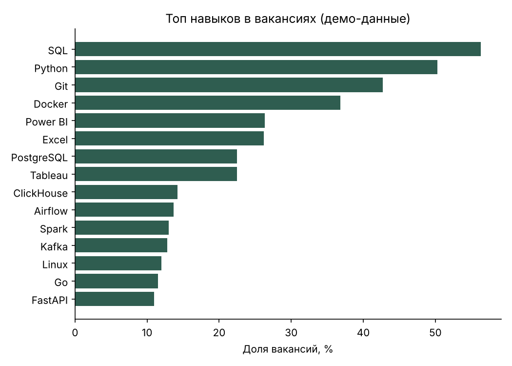

# Vacancy Analytics

*[Русская версия](README.md)*

A small Python and SQL project: it loads job postings into a SQLite database and answers questions about the job market with 8 SQL queries (window functions, CTEs, self-joins, views).

What the repository demonstrates:

- **database design**: a normalised schema (employers, vacancies, skills, a many-to-many link), indexes, a view that reduces salary to a single number;
- **SQL**: median via window functions (SQLite has no `MEDIAN`), skill pairs via a self-join, filters on sample size;
- **Python without extra dependencies**: the standard library; `matplotlib` is needed only for the chart;
- **tests**: 14 `unittest` tests, including a check of the SQL median against `statistics.median`.

## Quick start

```bash
git clone https://github.com/EminChyldyrly/vacancy-analytics
cd vacancy-analytics

python -m vacancy_analytics demo                 # a database of 600 demo vacancies
python -m vacancy_analytics report               # results of all queries
python -m vacancy_analytics report --chart docs/top_skills.png   # + chart (needs matplotlib)
```

Python 3.10+ is required (tested on 3.13). Query comments and report output are in Russian.

## Data

**Demo mode uses synthetic data.** It is generated with a fixed `seed`, so the project runs without internet access and the results are reproducible. No conclusions about the real market can be drawn from it: the patterns (for example, "Moscow pays more") are built into the generator (`sample_data.py`).

For real data there is a loader for the open hh.ru API:

```bash
python -m vacancy_analytics fetch "аналитик данных" --pages 3 --area 1
python -m vacancy_analytics report
```

> Loader status: written from the API documentation, **but it was not run in the development environment** (no internet access). Normalisation of the response is covered by tests on a sample record; the network part is untested. If the API changes its format or access rules, `hh_client.py` will need to be updated.
> Skills for real vacancies are extracted from the title and short description using a dictionary of patterns (`skills.py`), so they are incomplete: detailed requirements appear only on the vacancy page.

## Database schema

```
employers(id, name)
vacancies(id, title, employer_id → employers, city, salary_from, salary_to,
          currency, experience, remote, published_at, url)
skills(id, name)
vacancy_skills(vacancy_id → vacancies, skill_id → skills)

v_vacancy_salary — view: vacancies + employer + salary_mid
```

`salary_mid` is the midpoint of the salary range, or the single bound if only one is given. Salaries not in roubles are excluded from the calculations so that currencies are not mixed.

## Queries

They live in `vacancy_analytics/queries/`, each with a title in its first line.

| File | Question |
|------|----------|
| `01_median_salary_by_city.sql` | Median salary by city |
| `02_top_skills.sql` | Which skills appear most often |
| `03_salary_by_skill.sql` | Average salary by skill |
| `04_salary_by_experience.sql` | How salary grows with experience |
| `05_remote_share_by_month.sql` | Share of remote vacancies by month |
| `06_top_employers.sql` | Who posts the most vacancies |
| `07_skill_pairs.sql` | Which skills are required together |
| `08_sql_salary_gap.sql` | Salary in vacancies with and without SQL |

Example output on the demo data: [`docs/sample_report.txt`](docs/sample_report.txt).



### Why query 8 says "correlation"

On the demo data, vacancies that mention SQL turn out to pay **less** on average than vacancies that do not. This does not mean SQL lowers pay: SQL is mentioned more often in analyst vacancies, and in the generator analysts earn less than developers and data engineers. The difference comes from the mix of professions, not the skill. To test the effect of a skill, one should compare vacancies within the same role and with the same experience; this is the natural next extension of the project.

## Tests

```bash
python -m unittest discover -s tests -v
```

## Structure

```
vacancy_analytics/
  schema.sql       schema and view
  db.py            connection, loading (re-loading is safe)
  sample_data.py   demo data generator
  hh_client.py     vacancy loader for hh.ru
  skills.py        skill extraction from text
  analysis.py      running queries, tables, chart
  cli.py           commands demo / fetch / report
  queries/*.sql    8 analytical queries
tests/             unittest
docs/              sample report and chart
```

## Ideas for development

- comparing salaries within a single role (removing the effect of profession mix);
- loading the full vacancy description and extracting skills more accurately;
- scheduled periodic collection and week-by-week dynamics;
- migration to PostgreSQL.

## License

MIT, see [LICENSE](LICENSE).
