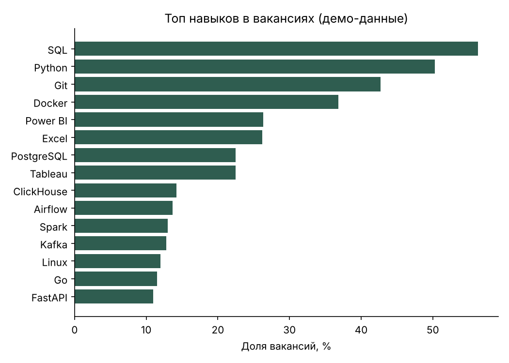

# Vacancy Analytics

*[English version](README.en.md)*

Небольшой проект на Python и SQL: загружает вакансии в базу SQLite и отвечает на вопросы о рынке с помощью 8 SQL-запросов (оконные функции, CTE, самосоединения, представления).

Что видно из репозитория:

- **проектирование базы**: нормализованная схема (работодатели, вакансии, навыки, связь «многие ко многим»), индексы, представление с приведением зарплаты к одному числу;
- **SQL**: медиана через оконные функции (в SQLite нет `MEDIAN`), пары навыков через самосоединение, фильтры по размеру выборки;
- **Python без лишних зависимостей**: стандартная библиотека; `matplotlib` нужен только для графика;
- **тесты**: 14 тестов на `unittest`, включая сверку SQL-медианы с `statistics.median`.

## Быстрый старт

```bash
git clone <ссылка на этот репозиторий>
cd vacancy-analytics

python -m vacancy_analytics demo                 # база из 600 демо-вакансий
python -m vacancy_analytics report               # результаты всех запросов
python -m vacancy_analytics report --chart docs/top_skills.png   # + график (нужен matplotlib)
```

Нужен Python 3.10+ (проверено на 3.13).

## Данные

**Демо-режим использует синтетические данные.** Они генерируются с фиксированным `seed`, чтобы проект запускался без интернета и результаты были воспроизводимыми. По ним нельзя делать выводы о реальном рынке: закономерности (например, «Москва платит больше») заложены в генератор (`sample_data.py`).

Для реальных данных есть загрузчик из открытого API hh.ru:

```bash
python -m vacancy_analytics fetch "аналитик данных" --pages 3 --area 1
python -m vacancy_analytics report
```

> Статус загрузчика: написан по документации API, **но в среде разработки не запускался** (не было доступа в интернет). Нормализация ответа покрыта тестами на примере записи, сетевая часть не проверена. Если API изменит формат или правила доступа, править придётся `hh_client.py`.
> Навыки для реальных вакансий берутся из названия и краткого описания по словарю шаблонов (`skills.py`), поэтому они неполные: подробные требования есть только на странице вакансии.

## Схема базы

```
employers(id, name)
vacancies(id, title, employer_id → employers, city, salary_from, salary_to,
          currency, experience, remote, published_at, url)
skills(id, name)
vacancy_skills(vacancy_id → vacancies, skill_id → skills)

v_vacancy_salary — представление: вакансии + работодатель + salary_mid
```

`salary_mid` — середина вилки, а если указана одна граница, то она. Зарплаты не в рублях в расчёты не попадают, чтобы не смешивать валюты.

## Запросы

Лежат в `vacancy_analytics/queries/`, у каждого в первой строке заголовок.

| Файл | Вопрос |
|------|--------|
| `01_median_salary_by_city.sql` | Медианная зарплата по городам |
| `02_top_skills.sql` | Какие навыки встречаются чаще всего |
| `03_salary_by_skill.sql` | Средняя зарплата по навыкам |
| `04_salary_by_experience.sql` | Как растёт зарплата с опытом |
| `05_remote_share_by_month.sql` | Доля удалённых вакансий по месяцам |
| `06_top_employers.sql` | Кто публикует больше всего вакансий |
| `07_skill_pairs.sql` | Какие навыки требуются вместе |
| `08_sql_salary_gap.sql` | Зарплата в вакансиях с SQL и без |

Пример вывода на демо-данных: [`docs/sample_report.txt`](docs/sample_report.txt).



### Почему в запросе 8 написано «корреляция»

На демо-данных вакансии с SQL оказываются в среднем **дешевле** вакансий без него. Это не значит, что SQL снижает зарплату: SQL чаще упоминают в вакансиях аналитиков, а аналитики в генераторе получают меньше разработчиков и инженеров данных. Различие создаёт состав профессий, а не навык. Чтобы проверить влияние навыка, нужно сравнивать вакансии внутри одной роли и с одним опытом; это естественное следующее расширение проекта.

## Тесты

```bash
python -m unittest discover -s tests -v
```

## Структура

```
vacancy_analytics/
  schema.sql       схема и представление
  db.py            подключение, загрузка (повторная загрузка безопасна)
  sample_data.py   генератор демо-данных
  hh_client.py     загрузчик вакансий с hh.ru
  skills.py        поиск навыков в тексте
  analysis.py      запуск запросов, таблицы, график
  cli.py           команды demo / fetch / report
  queries/*.sql    8 аналитических запросов
tests/             unittest
docs/              пример отчёта и график
```

## Идеи для развития

- сравнение зарплат внутри одной роли (убрать влияние состава профессий);
- загрузка полного описания вакансии и более точное извлечение навыков;
- периодический сбор по расписанию и динамика по неделям;
- перенос на PostgreSQL.

## Лицензия

MIT, см. [LICENSE](LICENSE).
